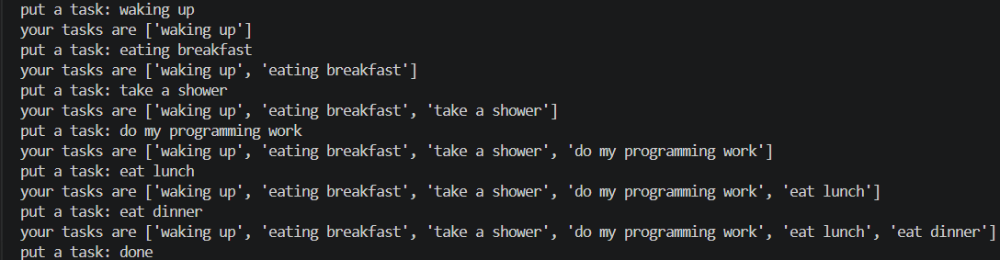
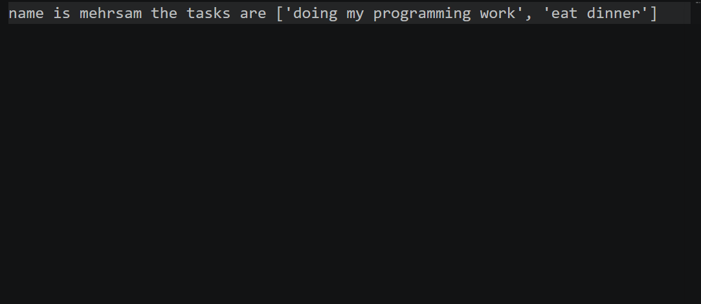
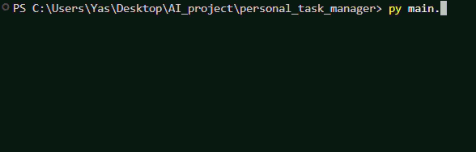

# Personal Task Manager


A simple task manager built with Python.

## Table of Contents

* [Features](#features)
* [Project Structure](#project-structure)
* [Requirements](#requirements)
* [Installation](#installation)
* [Environment Setup](#environment-setup)
* [Usage](#usage)
* [Example Output](#example-output)
* [Screenshot](#screenshot)
* [Demo](#demo)
* [Roadmap](#roadmap)
* [Contributing](#contributing)
* [License](#license)
* [Author](#author)

## Features

* Task System

  * Asks the user for their name
  * Allows the user to enter multiple tasks
  * Displays the current task list
  * Saves tasks in `tasks.txt` when the user finishes

* Admin Mode

  * Asks whether the user wants to open admin mode
  * Asks for the admin password
  * Checks if the password is correct
  * Loads the password from `.env`

## Project Structure

```text
personal_task_manager/

│   .env.example
│   .gitignore
│   main.py
│   README.md
│   requirements.txt
│   tasks.py
├───pictures
│       start.png
│       putting_tasks.png
│       end.png
├───gifs
│       demo.gif

```

### File Description

| File | Description |
| ------------------- | ------------------------------------------------------- |
| `main.py` | Main file used to run the task manager |
| `tasks.py` | Stores the task list |
| `requirements.txt` | Lists the Python package needed for the project |
| `.env.example` | Shows the environment variable needed by the project |
| `.gitignore` | Tells Git which files and folders should not be tracked |
| `README.md` | Contains the project documentation |
| `tasks.txt` | Stores the tasks when the user finishes |
| `pictures/` | Stores project screenshots |
| `pictures/start.png` | Screenshot of the app start |
| `pictures/putting_tasks.png` | Screenshot of the tasks section |
| `pictures/end.png` | Screenshot of the save informations |
| `gifs/` | Stores project demo GIFs |
| `gifs/demo.gif` | Shows the project demo |

## Requirements

Before running the project, make sure you have:

* `Python 3`
* `python-dotenv`

## Installation

1. Open a terminal in the project folder.

2. Check that Python is installed:

```bash
python --version
```

3. Install the Python package:

```bash
pip install python-dotenv
```

## Environment Setup

1. Create a `.env` file from `.env.example`:

```bash
cp .env.example .env
```

2. Open the new `.env` file.

3. Replace the example value with your own password:

```text
TASK_MANAGER_ADMIN_PASSWORD=your_password_here
```

4. Save the file.

> Do not commit your `.env` file because it may contain private information.

## Usage

1. Open a terminal in the project folder.

2. Run the task manager:

```bash
python main.py
```

3. Choose `yes` or `no` for admin mode.

4. If you choose `yes`, enter the password from your `.env` file.

5. Enter your name.

6. Enter your tasks one by one.

7. Type `done` when you finish.

8. Your tasks are saved in `tasks.txt`.

## Example Output

```text
do you want to open admin mode? yes/no: no

what is your name? mehrsam

Welcome mehrsam

put a task: learn python
your tasks are ['learn python']

put a task: practice git
your tasks are ['learn python', 'practice git']

put a task: done
```

## Screenshot

### Start App


### Putting Tasks


### Tasks Information


## Demo


## Roadmap

* [x] Add tasks
* [x] Display the current task list
* [x] Save tasks to a text file
* [x] Add admin password verification
* [ ] Load previously saved tasks when the program starts

## Contributing

## License

## Author

Created by [Mehrsam Bahmanyar](https://github.com/Genius-Progarmmer)