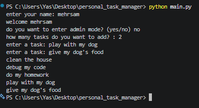

#  Personal Task anager


A simple task manager built with Python for learning git & github

## Features
- add multiple tasks
- save tasks
- load saved tasks
- admin mode
- set task priority

## Task priority
each task can have one of these priority levels:
- low
- medium
- high

## Requirements
- Python
- python-dotenv

## Project Structure
```text
personal_task_manager/
│   .env
│   .env.example
│   .gitignore
│   main.py
│   README.md
│   requirements.txt
│   tasks.py
│
├───images/
│       Animation.gif
│       screenshot.png
```

## Installation
Install the required packages:

```bash
python -m pip install -r requirements.txt
```

## Enviroment Setup
create `.env` file on the project folder

Use `.env.example` as a template

Add your admin password 

```.env
admin_pass=your_password_here
```
replace `your_password_here` with your own admin password

## Run the Program
run the main file:
```bash
python main.py
```

## Screenshot


## Demo
